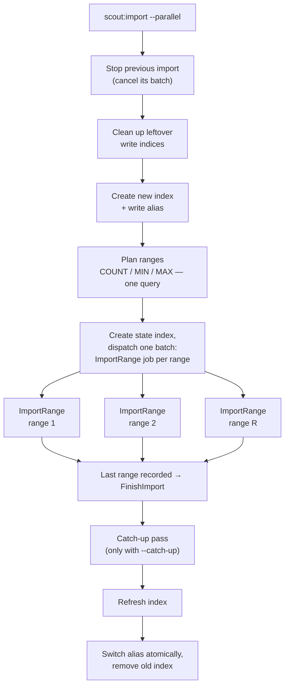
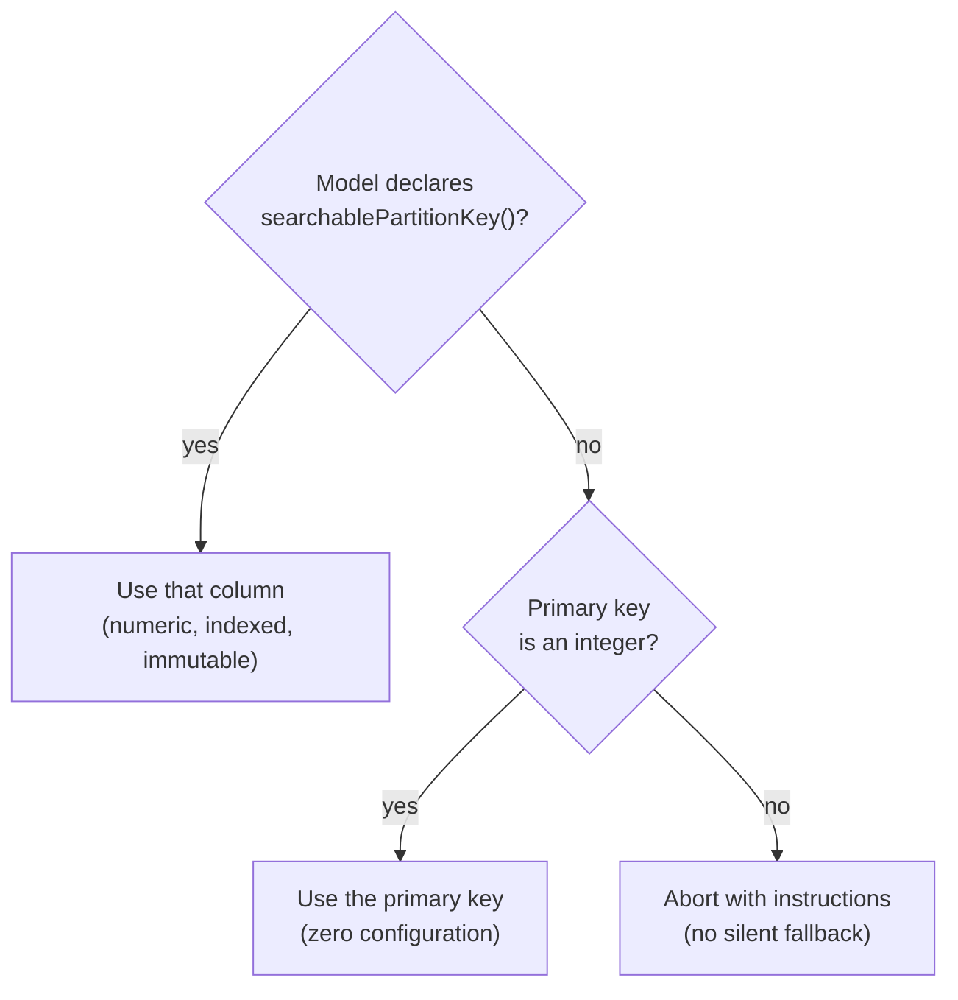
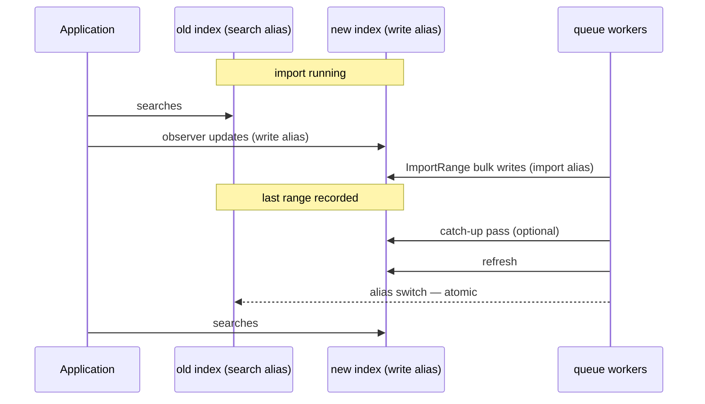

# Parallel import

`scout:import --parallel` rebuilds a search index using many queue workers at once, with zero downtime. This document explains how it works, what changed compared to the 8.0 alphas, and how failures are handled.

## The pipeline

The import runs in three phases. Only the middle phase is parallel.



- **Plan.** One aggregate query reads `COUNT`, `MIN`, and `MAX` of the partition key. The key space is cut into many small ranges. No scan of the table is needed to find the boundaries.
- **Fan out.** Every range becomes one queued `ImportRange` job inside a named [job batch](https://laravel.com/docs/queues#job-batching). All jobs go to **one queue**; parallelism equals the number of workers you run.
- **Finish.** Each range job records in a small state index that its range is done. The job that records the last range dispatches `FinishImport`: optional catch-up, refresh, atomic alias switch. No worker polls or waits. The console that started the import only watches, and reports success after the alias switch.

## How the import knows it is complete

Every Laravel queue delivers a job **at least once**. A worker can crash after it finished a job, or the database queue can fail to delete a finished job; the queue then runs the job again. The job batch counts every delivery as a finished job, so its pending count can reach zero while ranges are still running. In a test with 8 workers on MySQL 5.7, 72 job deletes failed in one import of 300,000 rows. So the import does not use the batch to decide when it is complete.

Instead, each import has a small **state index** next to its own index, for example `products_1791455338-state-0` with the alias `products_1791455338-state`:

| Record | Written when | Used for |
|---|---|---|
| `range-N` | a job wrote the last row of range N | knowing that every range is done |
| `handoff-…` | a job handed the rest of its range on | adding only one job for the same rows |
| `finish` | a job started the final step | starting the final step only once |
| `failure` | the final step failed | showing the reason in the console |

- A job records its own range first, and then reads all range records. So the job that records the last range sees every range recorded, and it starts `FinishImport`.
- Records are read only **by id** (`GET` / `mget`). A read by id sees every confirmed write at once. Search would see a write only after the next refresh, so it is never used here.
- Decisions that must happen once use **create-if-absent** (`op_type=create`): only one job can create the `finish` record. Another delivery of that same job may start the final step again, which is safe.
- Records are written through the alias with `require_alias`, so a late write after the state is gone is rejected instead of creating the index again.
- `FinishImport` deletes the state as its very last step. The console waits for that, and then checks that the search alias really points at the new index.

## Ranges and the partition key

```text
key space:     MIN ──────────────────────────────────────▶ MAX
         ( -∞ ── r1 )[ r2 )[ r3 ) ... [ rN ────▶ +∞ )    + [ NULL bucket ]
```

- Ranges are **half-open intervals** `[from, to)` — every row falls into exactly one range.
- **Both outer ranges are open-ended.** The first has no lower bound and the last has no upper bound, so the plan covers every key by construction. `MIN` and `MAX` only place the inner boundaries: rounding them, or a row inserted below `MIN` or above `MAX` during the import, cannot lose a row.
- Ranges are equal-width in *key space*, not in row count. A range with fewer rows simply finishes earlier and its worker picks the next job.
- A range with more rows than planned — many rows sharing one partition value, or one outlier key that stretches the key space — does not become one long job. A job processes at most `chunks_per_range` chunks and then hands the rest of its range to a new job in the same batch. No job runs long enough to hit the queue's `retry_after` or `--timeout`, so skew affects only how long the import takes, never whether it succeeds.
- Rows where the partition key is `NULL` are imported by a dedicated **null-bucket** job.
- Inside a range, the job pages with **keyset pagination** ordered by `(partition key, primary key)` — stable under concurrent inserts and deletes, unlike `OFFSET`.

Which column is the partition key:



A model with UUID keys enables parallel import like this:

```php
public function searchablePartitionKey(): string
{
    return 'legacy_id';
}
```

> **Warning:** the column must not change during the import. `updated_at` looks
> like a good candidate and is exactly the wrong one — a row whose value moves
> between ranges can be imported twice or skipped.

## Zero downtime and concurrent writes

Searches keep hitting the old index until the very last step. Writes that happen *during* the import reach the new index through Scout observers and the write alias:



Two delta channels exist:

| Change made through | Covered by | Needs `--catch-up`? |
|---|---|---|
| Eloquent (model events fire) | Scout observers → write alias | no |
| Raw SQL, bulk updates, other apps | catch-up pass (`updated_at ≥ import start`) | yes |

A range job writes rows it read moments earlier, so a live change can
land while a stale copy of the same row is still in flight. Every write
therefore carries a version, and Elasticsearch keeps the newest one,
whatever order the writes arrive in. A version has two parts:

1. **When the data became true.** An index write carries the row as of
   its last change: `updated_at`, or `deleted_at` when that is later. A
   delete from Scout's observers becomes true as it is sent, so it uses
   the current time — it applies even when sent from a model instance
   loaded before someone else edited the row.
2. **A rank, for ties within one second:**

| Writer | Rank | Version type |
|---|---|---|
| Import (range jobs, sequential import) | 0 | `external` — loses to anything equal or newer |
| Catch-up | 1 | `external` — it read after the import, so it beats import copies |
| Live (Scout's observers) | 2 | `external_gte` — a second change in the same second still lands |

That is what stops a product deleted mid-import from reappearing, and
an update made mid-import from being rolled back. Delete records are
kept for 12 hours (`index.gc_deletes`), so a slow import job cannot
outlive them. Models without an `updated_at` column carry no version
and keep the previous behaviour.

The catch-up pass runs right before the alias switch and is **off by
default**. It re-imports changed rows and removes rows that stopped
being searchable or were soft-deleted. A row deleted outright by raw
SQL leaves nothing to read, so catch-up cannot remove it. Models
without an `updated_at` timestamp are skipped with a logged warning.

## Superseding a running import

Starting a new `--parallel` import while one is running is safe:

1. The new import **cancels the previous batch** (found by name in `job_batches`).
2. Cancelled `ImportRange` jobs stop at their next chunk boundary.
3. A job that is mid-chunk writes through the **import alias** of its own import (for example `products_1791455338-import`) with `require_alias`. That alias points only at the old import's index, so a straggler can never pollute the new index.
4. The new import deletes the old import's index and its state index. The import alias goes with the index, so Elasticsearch rejects a late write instead of creating the index again. The old import's final step finds no state and stops.

## Failure behaviour

| Scenario | What happens |
|---|---|
| One range job fails (after 3 tries) | The batch cancels the remaining jobs. The alias never switches — searches keep working on the old index. The next import cleans up the leftover write index and state index. |
| The queue delivers a job twice | The job writes the same documents again with the same versions. It adds no second job for the rest of its range, and the import is published once. |
| The final step fails (after 3 tries) | The reason is recorded in the state, and the console shows it. The alias is not switched. |
| The whole import dies | Its index and state index stay until the next import of the same model, which removes them. |
| Rows deleted after planning | Range jobs find fewer rows and finish early. (The old implementation looped forever here.) |
| Rows inserted during the import | Covered by observers; keys above `MAX` also land in the open-ended last range. |
| Model not eligible for parallel | The command aborts with an error naming the model and the fix. |
| `job_batches` table missing | The import stops with a message that names the fix: `php artisan queue:batches-table`, then `php artisan migrate`. No job is queued, and the search alias is not changed. The next import removes the index and state index that this attempt created. |

## Breaking changes vs the 8.0 alphas

| Removed (alpha.3 / alpha.4) | Replaced by |
|---|---|
| `tracked_jobs` table, `TrackedJob` model, `elasticsearch.tracked_jobs` config | Laravel's standard `job_batches` table |
| Round-robin queues `elasticsearch-parallel-N`, `scout.chunk.handlers` | One shared queue, any number of workers |
| `OFFSET` paging for non-integer keys | Keyset pagination + `searchablePartitionKey()` |
| Polling loop asking every chunk for its state | Range records in Elasticsearch — the job that records the last range starts the final step |

If you ran the alpha's `tracked_jobs` migration, see the cleanup note in the [CHANGELOG](../CHANGELOG.md).

## Configuration reference

| Setting | Default | Meaning |
|---|---|---|
| `--parallel` | off | Use the parallel pipeline instead of the sequential one. |
| `--catch-up` | off | Re-import rows changed during the import before the alias switch. |
| `scout.chunk.searchable` | `500` | Rows per bulk request inside a range job. |
| `elasticsearch.parallel.chunks_per_range` | `8` | How much work one job carries: it sizes the planned ranges, and caps a job at `chunks_per_range × chunk size` rows before it hands the rest of its range on. Smaller values balance better; larger values mean fewer jobs. |
